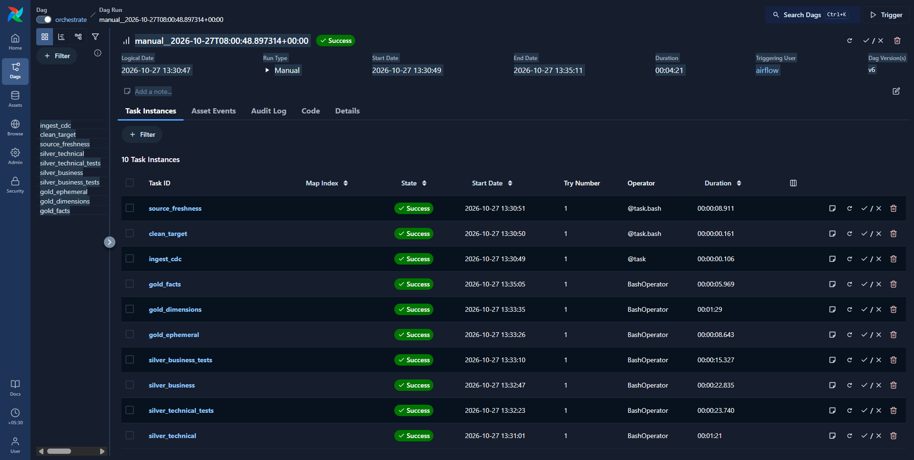
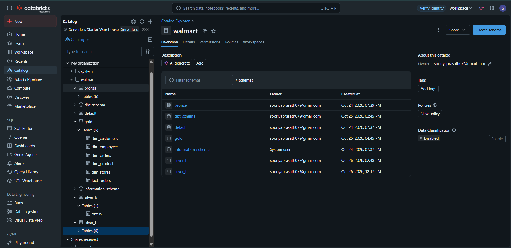
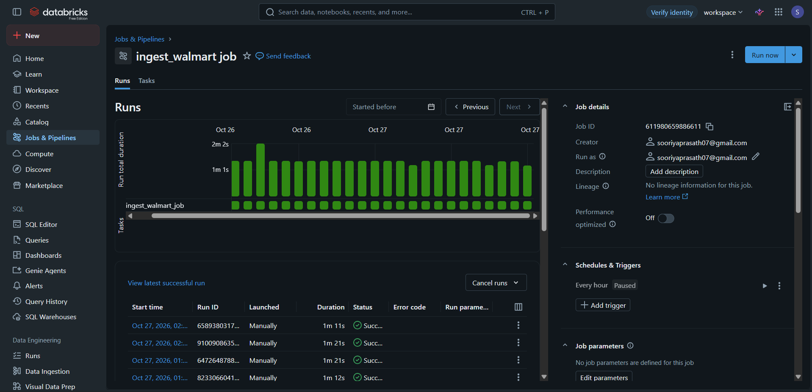
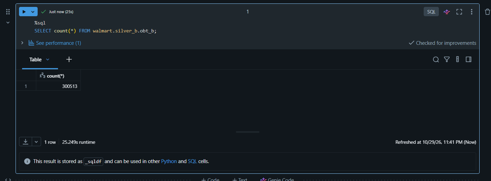
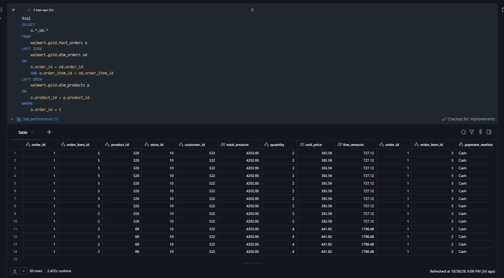

# Walmart Retail Lakehouse Pipeline

A data engineering project that demonstrates retail data ingestion, layered data processing, SQL transformations, dimensional modeling, data quality testing, and workflow orchestration using **Databricks, dbt, Apache Airflow and SQL**.

The project organizes retail data through a Medallion architecture, transforming source data into structured datasets for analytical queries.

## Overview

Retail analytics requires data to be organized, transformed, and validated before it can be used for reporting. This project implements a structured data pipeline that separates processing into Bronze, Silver and Gold layers.

The pipeline combines Databricks for data processing and storage, dbt for SQL-based transformations and testing, and Apache Airflow for coordinating and monitoring pipeline tasks.

The implementation also includes retail fact and dimension tables, SQL-based data validation and queries that join multiple datasets to retrieve order-level information.

## Architecture

The project follows the Medallion architecture, with separate layers for ingestion, transformation and analytics.

```text
                    Source Data
                         |
                         v
                   Data Ingestion
                         |
                         v
                    Bronze Layer
                         |
                         v
                 Data Transformation
                         |
                         v
                   Silver Layer
                         |
                         v
                 Data Quality Tests
                         |
                         v
                    Gold Layer
                         |
                         v
                Analytical Queries
```

**Workflow orchestration:** Apache Airflow coordinates pipeline tasks, while Databricks provides the environment for data processing and SQL execution.

The diagram represents the logical workflow. Individual dependencies and execution order are defined by the actual pipeline configuration.

### Medallion Layers

| Layer | Purpose |
|---|---|
| Bronze | Initial layer for ingested source data. |
| Silver | Layer for cleaning, standardization, and business-oriented transformations. |
| Gold | Layer containing analytical fact and dimension tables. |

This separation makes the pipeline easier to understand, maintain, test and extend.

## Technology Stack

| Technology | Role in the Project |
|---|---|
| Python | Supporting pipeline and automation logic. |
| SQL | Data transformations, joins, validation, and analytical queries. |
| Databricks | Data processing environment and catalog management. |
| dbt | SQL-based data modeling and transformation testing. |
| Apache Airflow | Workflow orchestration, execution monitoring, and task management. |
| Neon / PostgreSQL | Source database integration used in the project. |

*The technologies listed above describe the intended project stack. Refer to the implementation and configuration files to verify the exact role of each component.*

## Pipeline Workflow

### 1. Data Ingestion

The pipeline begins by bringing retail source data into the processing environment.

The project includes a Databricks job named `ingest_walmart_job`, which provides an execution history for monitoring ingestion runs.

**Key activities:**
- Prepare source data for processing.
- Execute the configured ingestion workflow.
- Monitor job status and execution duration.
- Make ingested data available for downstream transformations.

The Databricks job interface shows multiple successful runs.

### 2. Bronze Layer

The Bronze layer represents the initial stage of the Medallion architecture.

It provides a separate location for ingested data before subsequent transformation stages.

**Purpose:**
- Organize source data.
- Separate ingestion from downstream processing.
- Provide a starting point for the Silver-layer transformations.

### 3. Silver Layer

The Silver layer contains tables used in subsequent processing and analysis.

The Databricks catalog includes the schemas `silver_b` and `silver_t`, which organize Silver-layer data.

The project also includes an object named `obt_b` under `walmart.silver_b`.

**Key objectives:**
- Organize processed retail data.
- Apply the transformations defined in the project.
- Validate data using SQL and configured tests.
- Prepare datasets for downstream analytical modeling.

The precise transformations and quality rules are defined in the project code.

### 4. Gold Layer

The Gold layer contains structured tables intended for analytical queries.

The Databricks catalog includes the following tables:

| Table | Purpose |
|---|---|
| `fact_orders` | Stores order-related records for analysis. |
| `dim_orders` | Provides order-level attributes. |
| `dim_customers` | Organizes customer attributes. |
| `dim_products` | Organizes product attributes. |
| `dim_stores` | Organizes store attributes. |
| `dim_employees` | Organizes employee attributes. |

These tables provide a basis for joining retail datasets and querying order-related information.

The exact grain, keys, and relationships of each table should be verified against the model definitions.

### 5. Data Quality Testing

Data quality is an important part of a reliable data pipeline.

The Airflow task list includes:

- `silver_technical_tests`
- `silver_business_tests`

These tasks indicate separate technical and business testing stages in the workflow.

Examples of useful validation checks include:

- Record-count validation.
- Null-value checks.
- Duplicate-key checks.
- Required-column validation.
- Referential integrity checks.
- Business-rule validation.

The checks listed as examples should only be described as implemented features when the corresponding test definitions confirm them.

### 6. Analytical Queries

The Gold layer supports SQL queries that combine information across retail tables.

One implemented query joins:

- `walmart.gold.fact_orders`
- `walmart.gold.dim_orders`
- `walmart.gold.dim_products`

The query uses `order_id`, `order_item_id`, and `product_id` to connect the tables.

This allows order-related records to be examined alongside product attributes.

## Workflow Orchestration with Apache Airflow

Apache Airflow is used to coordinate and monitor the pipeline workflow.

The DAG run shown in the project interface contains 10 task instances:

| Task | Role |
|---|---|
| `ingest_cdc` | Ingestion-related task. |
| `clean_target` | Target preparation or cleanup task. |
| `source_freshness` | Source freshness validation. |
| `silver_technical` | Silver-layer technical processing. |
| `silver_technical_tests` | Silver-layer technical tests. |
| `silver_business` | Silver-layer business processing. |
| `silver_business_tests` | Silver-layer business tests. |
| `gold_ephemeral` | Gold-related ephemeral model processing. |
| `gold_dimensions` | Dimension-model processing. |
| `gold_facts` | Fact-model processing. |

The Airflow interface shows a successful manual DAG run, with all 10 task instances marked as successful.

This provides evidence that the displayed workflow execution completed without a reported task failure.

Airflow also provides task-level execution details, durations, run history, and status information for monitoring pipeline behavior.

## Implementation Evidence

The following screenshots document important parts of the project.

### 1. Airflow DAG Execution



**What this shows**

The Airflow interface displays a manually triggered DAG run with a `Success` status.

All 10 task instances are marked as successful, covering ingestion, source freshness checks, Silver-layer processing, testing, and Gold-layer transformations.

**Why it matters**

This demonstrates workflow orchestration and provides execution-level evidence that the displayed pipeline run completed successfully.

### 2. Databricks Catalog and Data Organization



**What this shows**

The Databricks catalog contains the `walmart` catalog and schemas including:

- `bronze`
- `dbt_schema`
- `default`
- `gold`
- `silver_b`
- `silver_t`

The Gold schema contains fact and dimension tables, including `fact_orders`, `dim_customers`, `dim_products`, and `dim_stores`.

**Why it matters**

The catalog provides a view of how the project's data objects are organized across processing layers and analytical models.

### 3. Databricks Ingestion Job



**What this shows**

The `ingest_walmart_job` page displays its run history, including multiple successful executions and their durations.

The interface also shows that the hourly schedule is paused in the captured configuration.

**Why it matters**

This demonstrates job execution monitoring and makes the ingestion job's operational status visible.

The screenshot establishes successful runs, but does not by itself establish that the job is currently running on an active hourly schedule.

### 4. Silver-Layer Table Validation



**What this shows**

A SQL query against `walmart.silver_b.obt_b` returns a count of **300,513 records**.

**Why it matters**

The result confirms that the queried table contains records and can be queried successfully in the displayed environment.

A record count alone does not prove data correctness or uniqueness. Additional validation is needed to establish those properties.

### 5. SQL Joins Across Gold-Layer Tables



**What this shows**

The SQL query joins the Gold-layer `fact_orders`, `dim_orders`, and `dim_products` tables to retrieve order-related information.

The displayed result includes identifiers and attributes such as order ID, order-item ID, product ID, customer ID, store ID, quantity, unit price, line amount, and payment method.

**Why it matters**

This demonstrates SQL-based joins across multiple analytical tables.

The screenshot also shows repeated records. The join conditions and table grain should therefore be checked before interpreting the output as unique order-level data.

## Repository Structure

The following is a suggested layout for the repository. Keep the existing implementation directories and filenames where they differ.

```text
walmart-retail-lakehouse-pipeline/
│
├── dags/
│   ├── orchestrator.py
│   └── test.py
│
├── dbt/
│   ├── models/
│   ├── tests/
│   ├── dbt_project.yml
│   └── profiles.yml
│
├── result/
│   └── images
│        ├── airflow-dag-run.png
│        ├── catalog.png
│        ├── ingest-walmart-job.png
│        ├── ob-table.png
│        └── order-query-results.png
│
├── README.md
└── .gitignore
```

This is an illustrative structure, not a claim that every listed file or directory exists in the current repository. Update it to match the actual GitHub files.

**Important:** Do not commit passwords, API tokens, access keys, or other credentials. Keep sensitive configuration in environment variables or an appropriate secrets-management mechanism.

## Getting Started

### Prerequisites

Before running the pipeline, ensure you have access to the services and tools required by the implementation:

- Python
- Git
- Databricks workspace and appropriate permissions
- Apache Airflow environment
- dbt and the required adapter
- Access to the configured source database, if applicable

The exact versions and installation steps depend on the project's configuration.

### 1. Clone the Repository

```bash
git clone https://github.com/Sooriya07/walmart-retail-lakehouse-pipeline.git
cd walmart-retail-lakehouse-pipeline
```

### 2. Configure the Environment

Install the dependencies specified by the project, if a dependency file is provided.

Configure the required database connections, Databricks access, and Airflow settings using the actual configuration files and environment variables.

Do not copy credentials into the repository.

### 3. Configure dbt

Review `dbt_project.yml` and the profile configuration to identify the configured project, target, adapter, and connection settings.

Make sure the dbt profile is available in the expected location and that its credentials are configured securely.

### 4. Configure Airflow

Review the DAG source code and ensure that the required connections, variables, environment settings, and dependencies are available in the Airflow environment.

### 5. Execute the Pipeline

Run the DAG using the configured Airflow environment.

Monitor task status and inspect logs if any task fails.

The exact execution commands depend on the current Airflow deployment and repository configuration.

## Validation and Results

The implementation evidence shown in the repository includes:

- A successful Airflow DAG run with 10 successful task instances.
- A Databricks catalog containing Bronze, Silver, and Gold schemas.
- Multiple successful runs displayed for `ingest_walmart_job`.
- A SQL record-count result of 300,513 for `walmart.silver_b.obt_b`.
- A SQL query joining fact and dimension tables.

These results demonstrate execution and queryability in the captured environment. They should not be interpreted as proof of production readiness, complete data correctness, or guaranteed performance at larger scales.

## Key Learning Outcomes

This project provides practical experience with:

- Medallion architecture and layered data organization.
- Data ingestion and downstream processing.
- SQL transformations and joins.
- Fact and dimension table organization.
- dbt-based transformation workflows and testing.
- Apache Airflow DAG orchestration.
- Databricks catalog and job monitoring.
- SQL-based inspection and validation of processed data.

## Future Improvements

Potential improvements include:

- Strengthening incremental ingestion and change data capture.
- Expanding automated data quality checks.
- Adding explicit uniqueness and referential integrity tests.
- Improving failure handling, retries, and alerting.
- Documenting model dependencies and data lineage.
- Adding reproducible setup instructions and dependency versions.
- Investigating repeated rows in analytical joins.
- Measuring query and pipeline performance with representative workloads.

These are improvement opportunities, not claims about features already completed.

## Author

**Sooriyaprasath**

GitHub: [Sooriya07](https://github.com/Sooriya07)

---

*This repository documents a hands-on data engineering project focused on retail data processing, layered data modeling, SQL transformations, and workflow orchestration.*
